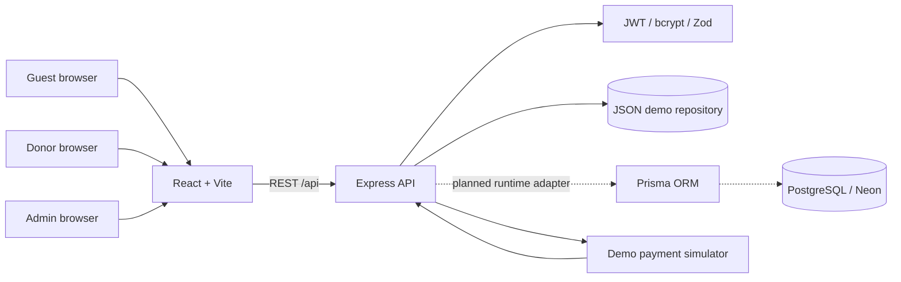

# Architecture

Goodwill follows a browser/client-server design. The Vite React client talks to a REST API through `/api`; in local development Vite proxies that prefix to Express. Express applies CORS, Helmet, JSON size limits, auth rate limits, Zod validation, and JWT role checks. The current API uses a JSON demo repository. PostgreSQL is the intended persistent store and is represented by the Prisma schema and migration files, but runtime Prisma wiring is not yet complete.

## Request flow

1. The browser submits a REST request; authenticated requests include a short-lived bearer token.
2. Express verifies role and validates the request shape.
3. Service logic creates a pending gift and payment attempt, then resolves the chosen demo outcome.
4. A successful outcome records a unique transaction reference and receipt; a failed outcome has no receipt.
5. The UI refreshes its relevant page data and displays the receipt or failure result.

## Main modules

- `client/src/main.jsx`: public routes, protected role routes, donor and admin views.
- `server/src/index.js`: REST routes, validation, auth, role enforcement, demo payment workflow.
- `server/src/store.js`: fictional seeded JSON store for no-PostgreSQL local demonstration.
- `server/prisma`: normalized PostgreSQL schema, initial migration, and seed fixtures.

## Deployment notes

Serve the built client behind a web server and expose the API under `/api`; configure CORS to the actual frontend origin. Set high-entropy secrets. Before production, connect the API to Prisma/PostgreSQL, use a managed database, add operational logging/backups, and put the demo simulator behind a clearly labeled environment mode.
