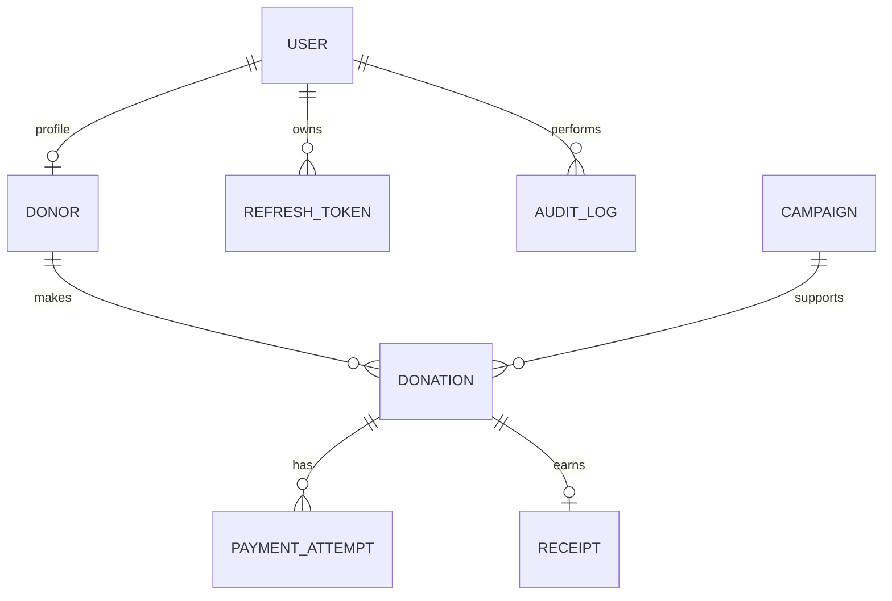

# Database design

The intended database is PostgreSQL (`donation_management_db`). All IDs are UUIDs. Money is stored as `DECIMAL(12,2)`. Enum fields constrain user role, campaign state, donation state, and attempt outcome. Unique constraints prevent duplicate email, campaign slug, receipt number, transaction reference, and receipt-per-donation. Indexes cover lookup by role, campaign status/date, donor history, donation status/date, audit chronology, and token expiry.

## Entities

| Model | Purpose and important relations |
| --- | --- |
| User | Login identity, password hash, role; optional one-to-one Donor; refresh tokens and audit events |
| Donor | Contact profile; optional linked User; donation history |
| Campaign | Fundraising description, category, goal, dates, status; donations |
| Donation | Monetary gift, anonymity, final status, campaign and optional donor; attempts and optional receipt |
| PaymentAttempt | Each simulated try, outcome, unique reference, attempt sequence |
| Receipt | Unique receipt number for one successful donation |
| AuditLog | Actor, action, entity, metadata and timestamp |
| RefreshToken | Hashed refresh token, owner, expiry and revocation timestamp |

## Relationship overview

The authoritative field definitions are in `server/prisma/schema.prisma`; the baseline SQL is in `server/prisma/migrations/20261112000000_initial/migration.sql`. Receipt creation must occur only after the payment outcome is successful, inside the same database transaction that updates the donation. The demo JSON repository mirrors the user-visible behavior but is not a relational database.
